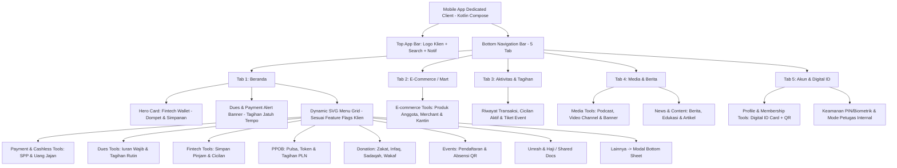

# Information Architecture (IA) & Sitemap Modular

**Proyek:** Redesign & Re-Architecture Master Platform Digibi (Dedicated White-Label Factory)  

**Tujuan Dokumen:** Menyesuaikan arsitektur navigasi untuk model **Dedicated Client Instance**. Setiap klien (koperasi, pesantren, sekolah, atau organisasi) mendapatkan aplikasi Android (via *Gradle Product Flavors*) dan domain Web Dashboard tersendiri, di mana modul yang tampil dikendalikan penuh oleh **Feature Flags (`enabledModules`)** sesuai kesepakatan saat *deal* tanpa perlu menghapus kode secara manual.

---

## 1. Mekanisme Provisioning Modul (1 Master Codebase $\rightarrow$ Dedicated Client)

```text
[1 MASTER CODEBASE DIGIBI (Angular & Kotlin)]
       │
       ├──► Klien A (Deal: Koperasi Simpan Pinjam + Mart + PPOB)
       │     └─► Aktif: COOPERATIVE, FINANCIAL, MARKETPLACE, PPOB, DUES_TOOLS
       │
       ├──► Klien B (Deal: Pesantren Cashless + ZISWAF + Media)
       │     └─► Aktif: CASHLESS_SYSTEM, ZISWAF_DONATION, MEDIA_TOOLS, NEWS_CONTENT
       │
       └──► Klien C (Deal: Ekosistem Lengkap 10 Modul Web & 11 Modul Mobile)
             └─► Aktif: Seluruh modul diaktifkan melalui konfigurasi database
```

---

## 2. Information Architecture — Web Dashboard (Modern Angular)

Seluruh **10 modul resmi Web Dashboard** dikelompokkan ke dalam **5 Domain Kerja Utama** di sidebar kiri. Menu hanya dirender jika modulnya aktif pada `enabledModules` klien dan sesuai dengan *role* admin yang login.

```mermaid
flowchart TD
    WEB[Web Dashboard Dedicated Client - Modern Angular] --> D1[1. Executive & Reporting]
    WEB --> D2[2. Cooperative & Financial System]
    WEB --> D3[3. Marketplace, Cashless & PPOB]
    WEB --> D4[4. Community Programs & Media]
    WEB --> D5[5. Gateway & White-Label Configurator]

    D1 --> D1A[Executive KPI Overview]
    D1 --> D1B[Reporting: Transaksi, Aktivitas & Business Insights]
    D1 --> D1C[Approval Queue Center]

    D2 --> D2A[Cooperative System: Member, Simpan Pinjam & Produk]
    D2 --> D2B[Financial System: Mutasi, Laporan & Reconciliation]

    D3 --> D3A[Marketplace Management: Merchant & Produk Anggota]
    D3 --> D3B[Cashless System: Operasional Kantin & Tagihan SPP]
    D3 --> D3C[PPOB Integration: Layanan Pembayaran Publik]

    D4 --> D4A[Donation Management: Workflow & Laporan ZISWAF]
    D4 --> D4B[Umrah & Hajj: Pendaftaran, Paket & Manajemen Jamaah]
    D4 --> D4C[Event & Shared Docs Repository]
    D4 --> D4D[Media Management: Konten Digital, Berita & Channel]

    D5 --> D5A[Payment Gateway: Pengaturan Metode Pembayaran]
    D5 --> D5B[White-Label Configurator: Modul Aktif, Theme M3, Logo & Menu SVG]
```



### Peta Cakupan 10 Modul Resmi Web Dashboard:
1. **Cooperative System:** Manajemen anggota (*membership*), simpan-pinjam, dan produk koperasi.
2. **Financial System:** Pencatatan transaksi, laporan keuangan, dan *reconciliation* (rekonsiliasi mutasi).
3. **Cashless System:** Operasional kantin sekolah/pesantren dan manajemen pembayaran SPP (*tuition payment*).
4. **Marketplace Management:** Pengelolaan daftar produk *merchant* dan produk anggota.
5. **Umrah & Hajj:** Manajemen pendaftaran, paket perjalanan, dan data jamaah.
6. **Donation Management:** Alur pengelolaan ZISWAF dan pelaporan penyaluran dana.
7. **Media Management:** Pengelolaan konten digital, berita, dan kanal media komunitas.
8. **PPOB Integration:** Pemrosesan transaksi pembayaran layanan publik (Pulsa, PLN, dll.).
9. **Payment Gateway:** Konfigurasi metode pembayaran digital yang terintegrasi.
10. **Reporting:** Laporan transaksi menyeluruh, aktivitas anggota, dan *business insights*.

---

## 3. Information Architecture — Mobile App (Android Kotlin Native)

Seluruh **11 modul resmi Mobile App** ditata untuk penggunaan satu tangan (*thumb-friendly*), tanpa fitur perpindahan organisasi (karena tiap klien memiliki aplikasi terpisah).



### Peta Cakupan 11 Modul Resmi Mobile App:
1. **Profile & Membership Tools:** Manajemen profil anggota dan **Digital ID** (Kartu Anggota Digital + QR).
2. **Fintech Tools:** Simpan-pinjam, pembayaran digital, dan dompet komunitas (*community wallet*).
3. **Payment Tools:** Pembayaran SPP (*tuition*), belanja harian (*daily spending*), dan transaksi komunitas.
4. **Dues Tools:** Iuran keanggotaan (*membership dues*), biaya berulang (*recurring fees*), dan manajemen tagihan.
5. **Cashless System Tools:** Transaksi non-tunai untuk lingkungan sekolah, pesantren, dan komunitas.
6. **E-commerce Tools:** Produk anggota, *merchant*, *marketplace*, dan kantin sekolah.
7. **PPOB:** Pulsa seluler, token PLN, tagihan listrik, dan layanan harian lainnya.
8. **Donation:** Layanan ZISWAF (zakat, infaq, sadaqah, wakaf).
9. **Events:** Pendaftaran acara, pencatatan kehadiran (*attendance*), dan pelacakan partisipasi.
10. **Media Tools:** Pemutar *podcast*, kanal video (*video channels*), dan *banner* informasi.
11. **News & Content:** Berita terkini, konten edukasi, dan artikel komunitas.

---

## 4. Tabel Standarisasi Module Key & Routing Lintas Platform

`Module Key` berfungsi ganda sebagai **Feature Flag** (saklar aktif/nonaktif modul saat *deal* dengan klien) sekaligus pengikat ikon SVG menu utama di database:

| Module Key (Feature Flag) | Modul Resmi Digibi | Web Route (Angular) | Mobile Deep Link (Compose) |
| :--- | :--- | :--- | :--- |
| `COOPERATIVE_SYSTEM` | Cooperative / Fintech Tools | `/cooperative/members` | `digibi://fintech/cooperative` |
| `FINANCIAL_SYSTEM` | Financial & Reconciliation | `/finance/reconciliation` | `digibi://fintech/wallet` |
| `CASHLESS_SYSTEM` | Cashless & Payment Tools | `/cashless/operations` | `digibi://cashless/hub` |
| `DUES_TOOLS` | Dues & Recurring Billing | `/finance/dues` | `digibi://dues/bills` |
| `MARKETPLACE_MART` | Marketplace / E-commerce Tools | `/marketplace/products` | `digibi://mart/catalog` |
| `PPOB_SERVICE` | PPOB Integration | `/ppob/transactions` | `digibi://ppob/hub` |
| `ZISWAF_DONATION` | Donation Management | `/donation/campaigns` | `digibi://donation/ziswaf` |
| `UMRAH_HAJJ` | Umrah & Hajj | `/pilgrimage/packages` | `digibi://pilgrimage/list` |
| `EVENTS_ATTENDANCE` | Events & Attendance | `/community/events` | `digibi://events/list` |
| `MEDIA_TOOLS` | Media Management / Tools | `/media/channels` | `digibi://media/av-hub` |
| `NEWS_CONTENT` | News & Educational Content | `/media/articles` | `digibi://news/feed` |
| `PROFILE_DIGITAL_ID` | Profile & Digital ID | `/cooperative/id-cards` | `digibi://profile/digital-id` |
| `PAYMENT_GATEWAY` | Payment Gateway Config | `/settings/payment-gateway` | *(Backend / Checkout SDK)* |
| `REPORTING_INSIGHTS` | Reporting & Insights | `/reporting/analytics` | *(Admin Web Only)* |
| `WHITE_LABEL_CONFIG` | White-Label Provisioning | `/settings/white-label` | *(Digibi / Admin Web Only)* |