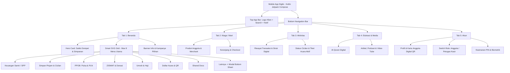

# Dokumen 03: Information Architecture (IA) & Sitemap Modular

**Proyek:** Redesign & Re-Architecture Master Platform Digibi (White-Label Ecosystem)  
**Tujuan Dokumen:** Menetapkan struktur navigasi baru yang bersih, skalabel, dan konsisten antara **Web Dashboard (Angular)** dan **Mobile App (Android Kotlin Native)** untuk menampung seluruh 4 pilar bisnis dan 7 modul ekosistem Digibi.

---

## 1. Information Architecture — Web Dashboard (Modern Angular)

Sidebar datar pada sistem lama dirombak menjadi **5 Domain Kerja Utama** dengan hierarki maksimal 2 tingkat agar pengurus cepat menemukan fitur tanpa *scrolling* berlebihan.

```mermaid
flowchart TD
    WEB[Web Dashboard Digibi - Modern Angular] --> D1[1. Executive Overview]
    WEB --> D2[2. Core Koperasi & Keuangan]
    WEB --> D3[3. Niaga & PPOB]
    WEB --> D4[4. Program Komunitas & Event]
    WEB --> D5[5. CMS, Organisasi & White-Label]

    D1 --> D1A[Ringkasan KPI & Grafik Arus Kas]
    D1 --> D1B[Pusat Persetujuan / Approval Queue]

    D2 --> D2A[Keanggotaan / Membership]
    D2 --> D2B[Dompet & Mutasi Top Up]
    D2 --> D2C[Simpanan: Pokok, Wajib, Sukarela]
    D2 --> D2D[Pembiayaan & Produk Cicilan]
    D2 --> D2E[Laporan Keuangan & Otorisasi]

    D3 --> D3A[Katalog Mart & Merchant]
    D3 --> D3B[Pesanan & Cross-Selling Koperasi]
    D3 --> D3C[Kantin Sekolah Cashless]
    D3 --> D3D[Transaksi & Margin PPOB]

    D4 --> D4A[Keuangan Santri / SPP]
    D4 --> D4B[Kampanye ZISWAF & Donasi]
    D4 --> D4C[Pendaftaran Umrah & Haji]
    D4 --> D4D[Manajemen Acara & Absensi QR]

    D5 --> D5A[Shared Docs Repository]
    D5 --> D5B[Media Online: Podcast, Video, Banner]
    D5 --> D5C[Manajemen Aset & Karyawan]
    D5 --> D5D[White-Label Studio: Theme, Logo & SVG]
```

### Rincian Peningkatan UX Navigasi Web:
* **Global Tenant Switcher (Top Bar Kiri):** Memudahkan `SUPER_ADMIN` atau pengurus jaringan koperasi bertingkat (*multilayer*) berpindah cabang/komunitas.
* **Approval Queue Badge (Top Bar Kanan):** Mengumpulkan seluruh pengajuan tertunda (anggota baru, pengajuan pinjaman/cicilan, pencairan dana) dalam satu laci notifikasi cepat.
* **White-Label Studio (`D5D`):** Panel khusus bagi `TENANT_ADMIN` untuk mengubah warna M3, mengunggah logo *light/dark*, memilih mode ikon SVG (`tinted` vs `multicolor`), dan mengatur urutan menu Mobile App secara *drag-and-drop*.

---

## 2. Information Architecture — Mobile App (Android Kotlin Native)

Struktur Mobile App dirancang untuk penggunaan satu tangan (*thumb-friendly*) dengan memisahkan navigasi inti di **Bottom Navigation Bar (5 Tab)** dan fitur layanan dinamis di **Beranda (4-Column SVG Grid)**.

### Aturan Penempatan Menu di Beranda Mobile (`W2`):
* **Batas Maksimal 8 Ikon (2 Baris $\times$ 4 Kolom):** Mencegah layar beranda memanjang ke bawah dan menjaga ukuran target sentuh (*touch target*) minimal `48dp x 48dp`.
* **Overflow Bottom Sheet (`Lainnya`):** Jika klien mengaktifkan lebih dari 7 layanan (misalnya menambahkan `Daftar BaitulMal`, `Kantin`, dll.), ikon ke-8 otomatis menjadi tombol `Lainnya` yang membuka *Modal Bottom Sheet* berisi seluruh layanan tambahan klien.
* **Contextual Officer Banner:** Jika akun memiliki role `FIELD_OFFICER`, muncul kartu akses cepat **Mode Petugas (`Kasir Blanja&Tunai` / `Scan QR Acara`)** tepat di bawah kartu saldo tanpa mengotori grid layanan anggota.

---

## 3. Peta Routing Teknis (Angular Routes & Compose Deep Links)

Tabel ini menjadi jembatan standar penamaan halaman antara tim desain, front-end Angular, front-end Kotlin, dan konfigurasi `route` di tabel `tenant_menus` database:

| Module Key (Database) | Web Route (Angular) | Mobile Deep Link (Jetpack Compose) | Parameter Utama |
| :--- | :--- | :--- | :--- |
| `DASHBOARD` | `/dashboard` | `digibi://home` | `tenantId` |
| `WALLET` | `/finance/wallets` | `digibi://wallet/history` | `walletType` (`DOMPET` / `SIMPANAN`) |
| `SAVINGS_LOANS` | `/cooperative/loans` | `digibi://finance/installments` | `productId` |
| `CASHLESS_SCHOOL` | `/community/school` | `digibi://school/billing` | `studentId` |
| `MART` | `/commerce/mart` | `digibi://mart/catalog` | `categoryId`, `productId` |
| `PPOB` | `/commerce/ppob` | `digibi://ppob/hub` | `serviceType` (`PULSA`, `PLN_TOKEN`, `PLN_BILL`) |
| `ZISWAF` | `/community/ziswaf` | `digibi://ziswaf/campaigns` | `campaignId` |
| `UMRAH_HAJI` | `/community/umrah-haji` | `digibi://pilgrimage/packages` | `packageType` |
| `EVENTS` | `/community/events` | `digibi://events/list` | `eventId` |
| `SHARED_DOCS` | `/cms/documents` | `digibi://docs/repository` | `docId` |
| `MEDIA_ONLINE` | `/cms/media` | `digibi://media/feed` | `mediaType` (`ARTICLE`, `PODCAST`, `VIDEO`) |
| `WHITE_LABEL_CONFIG` | `/settings/white-label` | *(Hanya tersedia di Web Dashboard)* | `tenantId` |