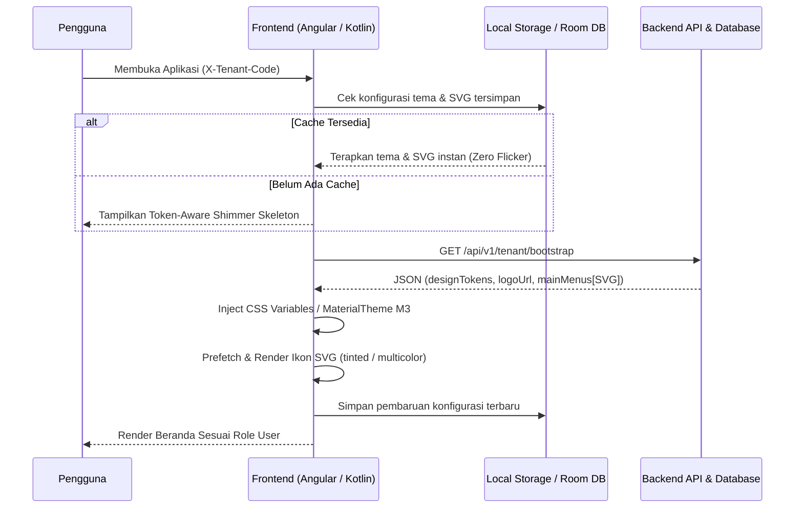
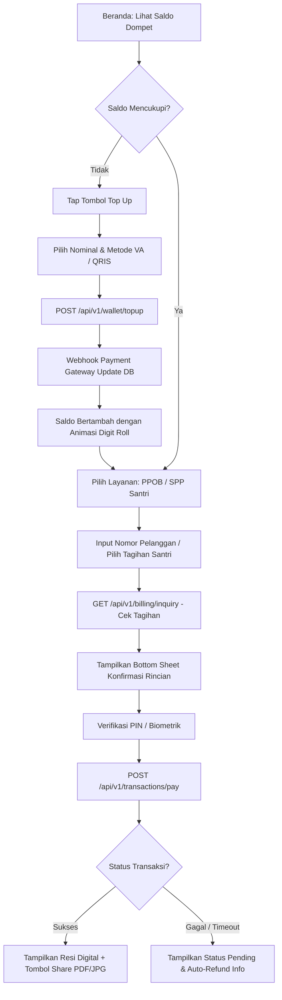
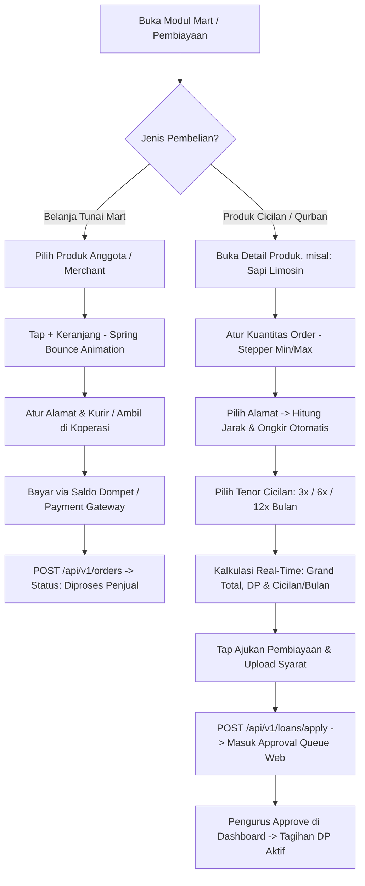
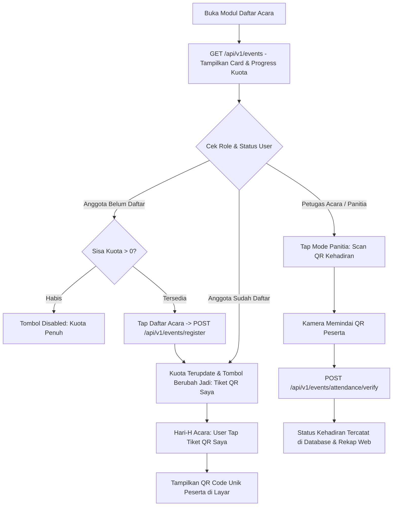
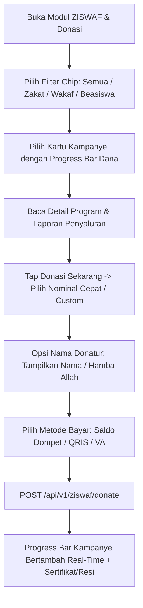

# Dokumen 04: User Flows & Edge Cases (Frontend-to-Database)

**Proyek:** Redesign & Re-Architecture Master Platform Digibi (White-Label Ecosystem)  
**Tujuan Dokumen:** Memetakan alur interaksi pengguna langkah demi langkah beserta pertukaran data antara antarmuka (Angular / Kotlin) dan API Database, lengkap dengan penanganan *edge cases* (kondisi error, offline, dan data kosong).

---

## 1. Flow 1: App Bootstrapping & Dynamic White-Label Injection

Alur ini dijalankan pertama kali saat Web Dashboard atau Android App dibuka untuk menerapkan identitas visual klien secara *runtime* tanpa *rebuild*.

---

## 2. Flow 2: Transaksi Keuangan, Top Up & Pembayaran PPOB / SPP

Alur terpadu untuk transaksi saldo likuid (`Dompet`) yang mencakup pengisian saldo, pembayaran tagihan `PPOB` (Pulsa/PLN), dan pelunasan `SPP Santri`.

---

## 3. Flow 3: Niaga Mart & Simulasi Pembiayaan Cicilan

Menggantikan layar *existing* `Mart` (yang kaku) dan `Product Cicilan` (yang berbentuk struk mentah) menjadi alur belanja dan simulasi kredit yang interaktif.

---

## 4. Flow 4: Pendaftaran Acara & QR Code Attendance

Menyelesaikan kebingungan tombol ganda (`Absen Member` vs `Absen`) pada layar *existing* `Daftar Acara` dengan memisahkan alur peserta dan alur petugas melalui status kontekstual.

---

## 5. Flow 5: Donasi & ZISWAF Berbasis Kampanye

Mengubah layar `New Donasi` yang sebelumnya hanya berisi 6 ikon statis menjadi alur penghimpunan dana yang transparan.

---

## 6. Matriks Edge Cases & Penanganan Error (Front-End Checklist)

Setiap komponen di Angular dan Kotlin Compose wajib menangani kondisi batas (*edge cases*) berikut sebelum dinyatakan lulus tahap *testing*:

| Skenario Edge Case | Modul Terdampak | Perilaku UI yang Wajib Diterapkan |
| :--- | :--- | :--- |
| **SVG Icon CDN Gagal Dimuat / Timeout** | Beranda, PPOB, ZISWAF | Jangan tampilkan kotak kosong atau ikon rusak. Render *default vector icon* bawaan aplikasi yang diwarnai dengan `--dg-icon-tint` klien. |
| **Data Kosong (*Empty State*)** | Shared Docs, Daftar Acara, Mart, Riwayat | Tampilkan ilustrasi vektor ringan, judul penjelas (misal: *"Belum ada dokumen dibagikan"*), dan tombol tindakan jika relevan (misal: *"Reset Filter"*). |
| **Koneksi Internet Terputus (*Offline*)** | Semua Modul | Tampilkan *Non-Intrusive Top Banner* (*"Mode Offline — Menampilkan data terakhir"*). Di Android Kotlin, baca data terakhir dari **Room DB** untuk tampilan baca. |
| **Saldo Berubah Saat Proses Checkout** | Mart, PPOB, ZISWAF | Jika transaksi gagal karena saldo terpotong di sesi lain, tampilkan *Dialog/Bottom Sheet* informatif dengan tombol langsung menuju halaman **Top Up**. |
| **Multi-Role User Login** | Beranda Mobile & Web | Jika pengguna memiliki role `MEMBER` sekaligus `FIELD_OFFICER`, sediakan *Role Switcher* tanpa perlu *logout* dan *login* ulang. |
| **Kontras Warna Klien Terlalu Terang** | White-Label Theme Engine | Jika klien memilih warna `brandPrimary` yang terlalu terang (misal kuning muda), sistem otomatis menghitung *luminance* untuk mengubah warna teks `onBrandPrimary` menjadi gelap (`#1E293B`) agar tetap memenuhi standar aksesibilitas WCAG AA. |