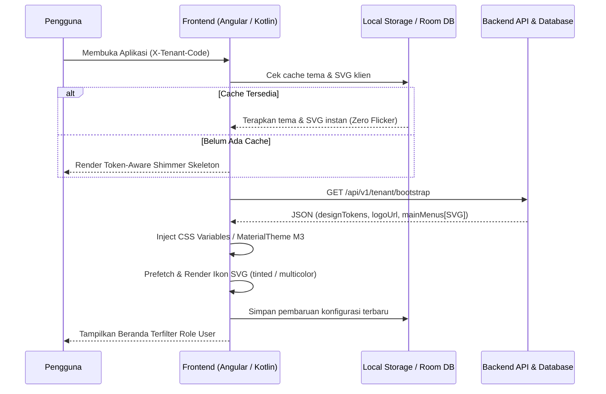
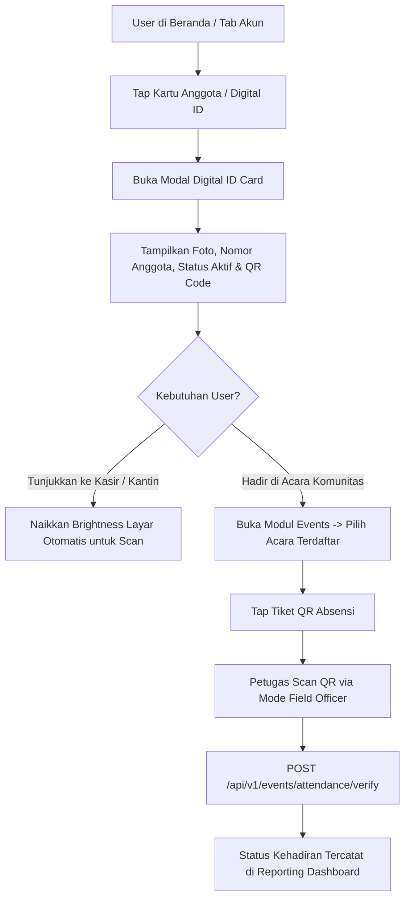
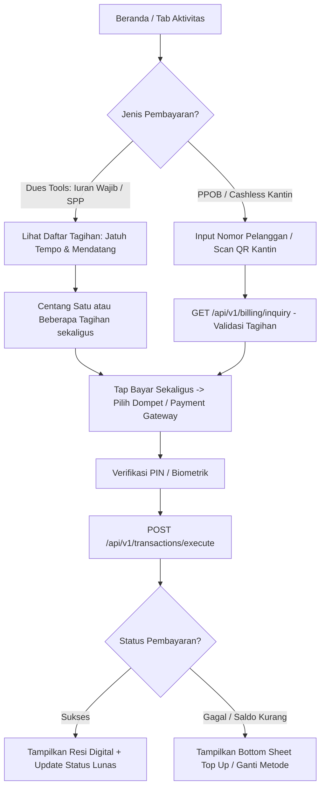
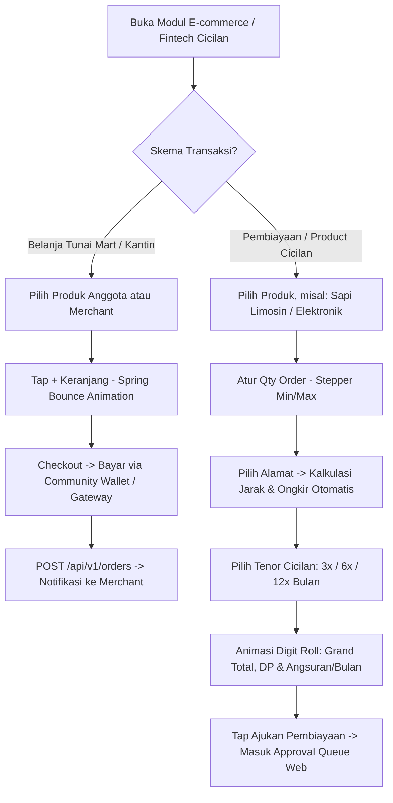
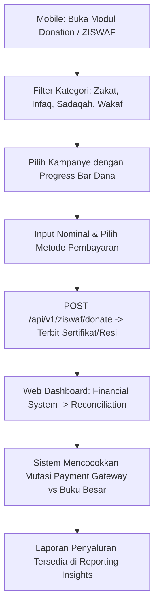

# Dokumen 04: User Flows & Edge Cases Lengkap (Revisi v2.0)

**Proyek:** Redesign & Re-Architecture Master Platform Digibi (White-Label Ecosystem)  
**Pembaruan v2.0:** Menambahkan alur **Profile & Digital ID Card** serta **Dues Tools (Iuran Berulang)** melengkapi 5 alur transaksi utama agar selaras dengan seluruh fitur *existing* yang sudah aktif di *backend*.

---

## 1. Flow 1: App Bootstrapping & Dynamic White-Label Injection

Alur pertama saat Web Dashboard atau Android App dibuka untuk memuat warna tema M3, logo klien, dan ikon menu SVG dari server secara *runtime*.

---

## 2. Flow 2: Digital ID Card & Event QR Attendance

Menghubungkan modul **Profile & Membership Tools (Digital ID)** dengan modul **Events** sehingga anggota memiliki kartu identitas resmi sekaligus tiket kehadiran digital.

---

## 3. Flow 3: Dues Tools (Iuran Rutin), Cashless SPP & PPOB

Memisahkan tagihan wajib berulang (**Dues Tools**: iuran anggota/SPP bulanan) dari transaksi sekali bayar (**PPOB** & **Payment Tools**).

---

## 4. Flow 4: E-Commerce Mart & Simulasi Cicilan (Fintech Tools)

Menyatukan belanja produk harian di **E-commerce Tools** dan pembelian bernilai besar secara kredit di **Product Cicilan**.

---

## 5. Flow 5: Donation (ZISWAF) & Financial Reconciliation

Alur penghimpunan dana sosial dari aplikasi anggota hingga pencocokan mutasi di **Financial System** Web Dashboard.

---

## 6. Matriks Edge Cases & Penanganan Error (Front-End Checklist)

| Skenario Edge Case | Modul Terdampak | Perilaku UI yang Wajib Diterapkan |
| :--- | :--- | :--- |
| **SVG Icon CDN Gagal Dimuat** | Beranda, PPOB, Donation | Render *fallback vector icon* lokal bawaan M3 yang otomatis diwarnai sesuai `--dg-icon-tint` klien. |
| **Data Kosong (*Empty State*)** | Dues Tools, Events, Shared Docs | Tampilkan ilustrasi ringan, pesan kontekstual (misal: *"Tidak ada tagihan jatuh tempo"*), dan tombol tindakan jika ada. |
| **Koneksi Internet Terputus** | Digital ID, Riwayat, Media | Tampilkan banner halus *"Mode Offline"*. **Digital ID Card** tetap dapat dibuka dari *cache* lokal (Room DB) agar anggota tetap bisa menunjukkan kartu identitas. |
| **Kontras Warna Klien Terlalu Terang** | White-Label Theme Engine | Hitung *relative luminance* dari `brandPrimary` klien; jika terlalu terang, otomatis ubah `onBrandPrimary` menjadi gelap (`#0F172A`) agar memenuhi standar aksesibilitas. |
| **Multi-Role User Login** | Beranda Mobile & Web | Sediakan *Role Switcher Pill* di header untuk berpindah instan antara *Mode Anggota* dan *Mode Petugas/Kasir* tanpa *logout*. |