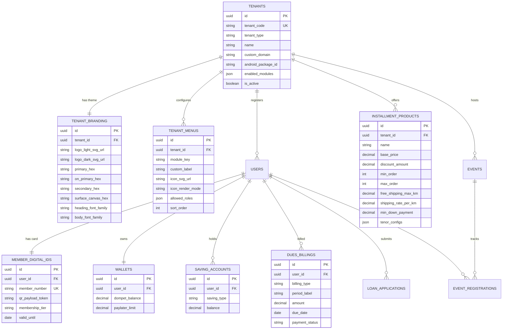

# Dedicated White-Label ERD & API Contract

**Proyek:** Redesign & Re-Architecture Master Platform Digibi (Dedicated White-Label Factory)  

**Tentang Dokumen:** Menyelaraskan alur *provisioning* dari **Digibi Studio** (`studio.digibi.co.id`) menuju database, serta mendokumentasikan konfigurasi tenant internal `digibi-master` untuk aplikasi Android **Digibi** (*All-in-One Showcase & QA App*) di samping *tenant* klien produksi.

---

## 1. Arsitektur Alur Provisioning & Integrasi Database

```text
[1. Internal & Deal Klien Baru]
       │
       ├──► [Build-Time / Domain Setup]
       │     • Android Internal Showcase: Gradle Flavor `digibiShowcase`
       │       (App Name: "Digibi" | Package: id.co.digibi.app | tenantCode = "digibi-master")
       │     • Android Klien Deal: Gradle Flavor `<klien>`
       │       (App Name: "<Nama Klien>" | Package: id.co.digibi.<klien> | tenantCode = "<kode-klien>")
       │     • Web: `studio.digibi.co.id` (Digibi Studio) & `<klien>.digibi.co.id` (Client Web)
       │
       └──► [Database Provisioning via Digibi Studio]
             • Isi tabel `tenants` (daftar `enabled_modules` — 100% aktif untuk `digibi-master`)
             • Isi tabel `tenant_branding` (warna M3, font heading & body, logo SVG)
             • Isi tabel `tenant_menus` (ikon SVG menu utama & label kustom)
                                    │
                                    ▼
             [Frontend App (Angular / Kotlin) Bootstrapping]
              Mengirim Header `X-Tenant-Code` -> GET /api/v1/tenant/bootstrap
              Otomatis merender UI sesuai tema, font, logo, SVG, & modul aktif!
```

---

## 2. Diagram ERD Database (Digibi Studio + Core Modules)



*(Catatan: Kolom `tenant_type` membedakan antara `"INTERNAL_SHOWCASE"` untuk aplikasi **Digibi** dan `"DEDICATED_CLIENT"` untuk masing-masing klien).*

---

## 3. Kontrak JSON API Kunci untuk System Architect (Backend)

### 3.1 Endpoint Bootstrapping (`GET /api/v1/tenant/bootstrap`)
Dipanggil otomatis menggunakan `X-Tenant-Code` (`"digibi-master"` untuk aplikasi Android **Digibi**, atau kode spesifik klien untuk aplikasi produksi klien):

```json
{
  "tenant": {
    "id": "tnt_dmi_01",
    "code": "dmi-pusat",
    "type": "DEDICATED_CLIENT",
    "name": "Dewan Masjid Indonesia",
    "logoLightUrl": "https://cdn.digibi.co.id/tenants/dmi/logo-light.svg",
    "logoDarkUrl": "https://cdn.digibi.co.id/tenants/dmi/logo-dark.svg"
  },
  "enabledModules": [
    "COOPERATIVE_SYSTEM",
    "FINANCIAL_SYSTEM",
    "CASHLESS_SYSTEM",
    "DUES_TOOLS",
    "MARKETPLACE_MART",
    "PPOB_SERVICE",
    "ZISWAF_DONATION",
    "EVENTS_ATTENDANCE",
    "MEDIA_TOOLS",
    "NEWS_CONTENT",
    "PROFILE_DIGITAL_ID",
    "PAYMENT_GATEWAY",
    "REPORTING_INSIGHTS"
  ],
  "designTokens": {
    "colors": {
      "brandPrimary": "#0F766E",
      "onBrandPrimary": "#FFFFFF",
      "brandSecondary": "#D97706",
      "surfaceCanvas": "#F8FAFC",
      "surfaceCard": "#FFFFFF",
      "walletDompetStart": "#0F766E",
      "walletSimpananAccent": "#0284C7"
    },
    "typography": {
      "headingFamily": "Outfit",
      "bodyFamily": "Plus Jakarta Sans"
    }
  },
  "mainMenus": [
    {
      "moduleKey": "CASHLESS_SYSTEM",
      "label": "Keuangan Santri",
      "iconSvgUrl": "https://cdn.digibi.co.id/tenants/dmi/icons/santri.svg",
      "iconRenderMode": "multicolor",
      "allowedRoles": ["MEMBER", "GUARDIAN"],
      "sortOrder": 1
    },
    {
      "moduleKey": "DUES_TOOLS",
      "label": "Iuran Wajib",
      "iconSvgUrl": "https://cdn.digibi.co.id/tenants/dmi/icons/dues.svg",
      "iconRenderMode": "tinted",
      "allowedRoles": ["MEMBER"],
      "sortOrder": 2
    },
    {
      "moduleKey": "ZISWAF_DONATION",
      "label": "ZISWAF",
      "iconSvgUrl": "https://cdn.digibi.co.id/tenants/dmi/icons/ziswaf.svg",
      "iconRenderMode": "tinted",
      "allowedRoles": ["MEMBER", "GUARDIAN", "FIELD_OFFICER"],
      "sortOrder": 3
    },
    {
      "moduleKey": "MARKETPLACE_MART",
      "label": "Mart",
      "iconSvgUrl": "https://cdn.digibi.co.id/tenants/dmi/icons/mart.svg",
      "iconRenderMode": "multicolor",
      "allowedRoles": ["MEMBER", "GUARDIAN"],
      "sortOrder": 4
    }
  ]
}
```

### 3.2 Endpoint Ringkasan Beranda Member (`GET /api/v1/member/home-summary`)
```json
{
  "memberProfile": {
    "fullName": "Ahmad Fauzi",
    "memberNumber": "DMI-2026-00841",
    "digitalIdQrToken": "DIGIBI:ID:DMI-2026-00841:9F8A2C",
    "roles": ["MEMBER"]
  },
  "wallets": {
    "dompetBalance": 90000,
    "simpananTotal": 50000,
    "simpananBreakdown": {
      "pokok": 25000,
      "wajib": 15000,
      "sukarela": 10000
    }
  },
  "duesAlert": {
    "unpaidCount": 1,
    "nearestBill": {
      "billId": "bill_nov_01",
      "title": "Iuran Wajib November 2026",
      "amount": 50000,
      "dueDate": "2026-11-25"
    }
  },
  "unreadNotifications": 3
}
```