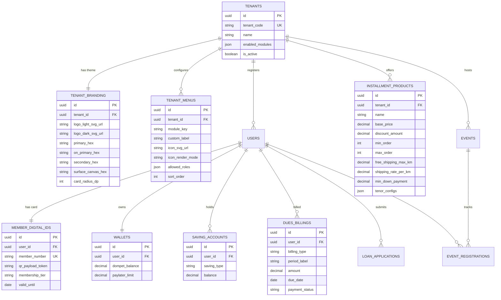

# Hybrid Database ERD & Legacy-to-Modern API Contract

**Proyek:** Redesign & Re-Architecture Master Platform Digibi (White-Label Ecosystem)  
**Strategi Integrasi:** *Hybrid Integration* — Memanfaatkan seluruh API dan tabel transaksi *existing* yang sudah berjalan (10 modul Web + 11 modul Mobile), sambil menambahkan lapisan tabel konfigurasi *White-Label* (`tenants`, `tenant_branding`, `tenant_menus`).

---

## 1. Arsitektur Jembatan Frontend-to-Database (Adapter Pattern)

Karena logika bisnis dan database *existing* sudah aktif, front-end modern (Angular & Kotlin) tidak terikat langsung pada struktur JSON lama yang berantakan. Kita menerapkan **Mapper / Adapter Layer** di sisi front-end:

```text
[Database Existing Digibi]                 [New White-Label Extension Tables]
 • cooperative, wallets, savings            • tenants
 • dues_billings, cashless_spp              • tenant_branding (M3 Hex & Logo SVG)
 • marketplace, ppob, ziswaf, events        • tenant_menus (Custom Label & Icon SVG)
             │                                              │
             ▼                                              ▼
    [Legacy REST APIs]                        [GET /api/v1/tenant/bootstrap]
             │                                              │
             └──────────────────────┬───────────────────────┘
                                    ▼
                 [Frontend Adapter / DTO Mapper Layer]
                  • Angular Services + Signals
                  • Kotlin Repository + StateFlow
                                    │
                                    ▼
               [Clean M3 UI Components (Zero Hardcoded Brand)]
```

---

## 2. Diagram ERD Database (White-Label Extension + Core Modules)



---

## 3. Kontrak JSON API Kunci untuk System Architect (Backend)

### 3.1 Endpoint Bootstrapping White-Label (`GET /api/v1/tenant/bootstrap`)
Endpoint baru yang diminta ke tim *backend* untuk menggerakkan tema M3 dan menu SVG klien secara dinamis (DMI sebagai contoh aja):

```json
{
  "tenant": {
    "id": "tnt_dmi_01",
    "code": "dmi-pusat",
    "name": "Dewan Masjid Indonesia",
    "logoLightUrl": "https://cdn.digibi.co.id/tenants/dmi/logo-light.svg",
    "logoDarkUrl": "https://cdn.digibi.co.id/tenants/dmi/logo-dark.svg"
  },
  "designTokens": {
    "brandPrimary": "#0F766E",
    "onBrandPrimary": "#FFFFFF",
    "brandSecondary": "#D97706",
    "surfaceCanvas": "#F8FAFC",
    "surfaceCard": "#FFFFFF",
    "walletDompetStart": "#0F766E",
    "walletSimpananAccent": "#0284C7",
    "cardRadiusDp": 16
  },
  "mainMenus": [
    {
      "moduleKey": "CASHLESS_SYSTEM",
      "label": "Keuangan Santri",
      "iconSvgUrl": "https://cdn.digibi.co.id/tenants/dmi/icons/santri.svg",
      "iconRenderMode": "multicolor",
      "allowedRoles": ["MEMBER", "GUARDIAN"],
      "sortOrder": 1
    },
    {
      "moduleKey": "DUES_TOOLS",
      "label": "Iuran Wajib",
      "iconSvgUrl": "https://cdn.digibi.co.id/tenants/dmi/icons/dues.svg",
      "iconRenderMode": "tinted",
      "allowedRoles": ["MEMBER"],
      "sortOrder": 2
    },
    {
      "moduleKey": "ZISWAF_DONATION",
      "label": "ZISWAF",
      "iconSvgUrl": "https://cdn.digibi.co.id/tenants/dmi/icons/ziswaf.svg",
      "iconRenderMode": "tinted",
      "allowedRoles": ["MEMBER", "GUARDIAN", "FIELD_OFFICER"],
      "sortOrder": 3
    },
    {
      "moduleKey": "MARKETPLACE_MART",
      "label": "Mart",
      "iconSvgUrl": "https://cdn.digibi.co.id/tenants/dmi/icons/mart.svg",
      "iconRenderMode": "multicolor",
      "allowedRoles": ["MEMBER", "GUARDIAN"],
      "sortOrder": 4
    }
  ]
}
```

### 3.2 Endpoint Ringkasan Beranda Member (`GET /api/v1/member/home-summary`)
Menggabungkan data dari modul *existing* (`Fintech Tools`, `Profile Digital ID`, dan `Dues Tools`) dalam satu panggilan ringan saat layar Beranda dibuka:

```json
{
  "memberProfile": {
    "fullName": "Ahmad Fauzi",
    "memberNumber": "DMI-2026-00841",
    "digitalIdQrToken": "DIGIBI:ID:DMI-2026-00841:9F8A2C",
    "roles": ["MEMBER"]
  },
  "wallets": {
    "dompetBalance": 90000,
    "simpananTotal": 50000,
    "simpananBreakdown": {
      "pokok": 25000,
      "wajib": 15000,
      "sukarela": 10000
    }
  },
  "duesAlert": {
    "unpaidCount": 1,
    "nearestBill": {
      "billId": "bill_nov_01",
      "title": "Iuran Wajib November 2026",
      "amount": 50000,
      "dueDate": "2026-11-25"
    }
  },
  "unreadNotifications": 3
}
```

---

## 4. Checklist Persiapan Tahap 3 (Siap Eksekusi Saat Laptop Tersedia)

Dengan selesainya dokumen `01` hingga `07`, seluruh fase riset dan konsep telah terkunci. Langkah eksekusi saat laptop siap adalah:
1. **Inisialisasi Workspace Angular (Gelombang 1):** Buat proyek Angular baru dengan *Standalone Components*, pasang CSS Variables dari `05-Design-Tokens.md`, dan bangun halaman *White-Label Branding Studio* (`06-Component-Wireframes.md`).
2. **Sinkronisasi API Bootstrap dengan System Architect:** Serahkan kontrak JSON pada Bagian `3.1` di atas kepada *backend* untuk menyediakan endpoint konfigurasi tema & ikon SVG per *tenant*.
3. **Inisialisasi Proyek Android Kotlin Native (Gelombang 2):** Buat proyek Jetpack Compose dengan *Material 3*, implementasikan `DigibiTheme` berbasis `CompositionLocal`, pasang `Coil 3` untuk rendering SVG dinamis, dan terapkan animasi *Shared Element* serta *Spring*.
